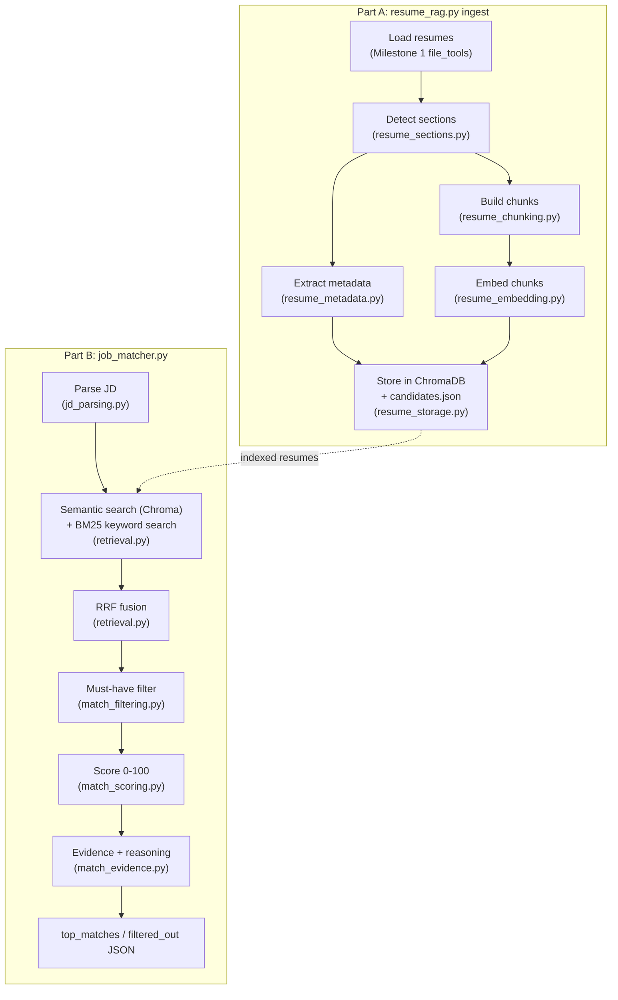

# Resume RAG + Job Matcher

A retrieval-augmented system for matching resumes to job descriptions. It splits resumes into chunks by section, embeds them locally with sentence-transformers, and stores them in ChromaDB with extracted metadata (name, skills, years of experience, education). It then ranks candidates for a job description using hybrid search: semantic similarity combined with BM25 keyword matching through Reciprocal Rank Fusion (RRF).

Each match gets a 0–100 score with reasoning based on which resume sections matched, and must-have requirements such as "5+ years Python" are filtered first.

Resumes are loaded with the file-system tools from Milestone 1, [file-system-assistant](https://github.com/puranderdua8/file-system-assistant).

The full design and the step-by-step implementation history (including deviations from the original plan, and why) are in [PLAN.md](PLAN.md).

## Setup

```bash
git clone --recursive https://github.com/puranderdua8/resume-rag-job-matcher.git
cd resume-rag-job-matcher
uv venv -p 3.13 .venv
source .venv/bin/activate
```

If you cloned without `--recursive`, pull in the Milestone 1 submodule separately:

```bash
git submodule update --init --recursive
```

Install dependencies. `torch` is the one package worth installing separately: a plain `pip install torch` pulls CUDA wheels worth gigabytes, which this project's CPU-only embedding and reranking don't need.

```bash
pip install torch --index-url https://download.pytorch.org/whl/cpu
uv pip install -r requirements-dev.txt
```

`requirements-dev.txt` covers everything needed to run the pipeline, the tests and the notebooks. `--llm` (optional prose reasoning via Gemini) needs a `GEMINI_API_KEY`; copy `.env.example` to `.env` and fill it in. Every other feature works with no API key.

## Pipeline



## CLI usage

Generate the synthetic dataset (36 resumes, 6 job descriptions):

```bash
python scripts/generate_dataset.py
```

Ingest resumes and inspect the index:

```bash
python resume_rag.py ingest
python resume_rag.py stats
```

```
Ingested collection: resumes__bge-small__section
Resumes loaded: 36
Chunks per section:
  certifications  18
  education       36
  experience      96
  projects        14
  skills          36
  summary         36
Timings (s):
  load                 0.25
  chunk_and_extract    0.12
  embed                6.22
  store                0.57
  total                7.15
```

Match a job description against the indexed resumes:

```bash
python job_matcher.py --jd data/job_descriptions/jd_senior_ml_engineer.txt
# or: python job_matcher.py --all
```

```json
{
  "job_description": "Senior Machine Learning Engineer",
  "top_matches": [
    {
      "candidate_name": "Ella Garcia",
      "resume_path": "data/resumes/ella_garcia.pdf",
      "match_score": 84,
      "matched_skills": ["Python", "Machine Learning", "TensorFlow", "PyTorch"],
      "relevant_excerpts": ["Junior ML Engineer, Fern Analytics\n...", "..."],
      "reasoning": "Strong match (84/100). Closest sections: experience (0.74), summary (0.72). Required-skill coverage: 100% of required skills. Must-have check: passed all must-haves.",
      "score_breakdown": { "semantic_cal": 0.771, "bm25_norm": 1.0, "required_coverage": 1.0, "preferred_coverage": 0.0 }
    }
  ],
  "filtered_out": [
    {
      "candidate_name": "Amelia Chen",
      "resume_path": "data/resumes/amelia_chen.pdf",
      "reasons": [
        "Python: 3.0 yrs < 5 required",
        "TensorFlow/PyTorch: 0.0 yrs < 3 required (any one of TensorFlow, PyTorch)",
        "Total experience: 3.0 yrs < 5 required"
      ]
    }
  ],
  "latency_ms": { "embed": 30.5, "semantic_search": 5.1, "bm25_search": 24.3, "total": 75.4 }
}
```

The must-have filter runs on extracted metadata (`skill_years`, `experience_years`, `education_level`), so Amelia Chen is filtered out here for having too few years of Python, not for a low similarity score. Add or override a must-have from the command line:

```bash
python job_matcher.py --jd data/job_descriptions/jd_backend_python_fastapi.txt \
    --must-have "3+ years Python" --soft
```

`--soft` keeps must-have failures in the ranking with a score penalty instead of dropping them. Other flags: `--rerank` (cross-encoder rerank of the top 20), `--llm` (Gemini paraphrase of the reasoning, falls back to the template on any error), `--mode semantic|keyword|hybrid`, `--model`/`--chunking` to pick a different indexed collection.

Compute metrics (retrieval accuracy, extraction accuracy, filter accuracy, latency):

```bash
python evaluate.py
```

Run the Step 6 experiment notebooks end to end:

```bash
jupyter nbconvert --to notebook --execute --inplace notebooks/0*.ipynb
```

## Design decisions

| Decision | Choice | Why |
|---|---|---|
| Reusing Milestone 1 | Git submodule at `vendor/file-system-assistant` | Reuses M1 visibly without duplicating code |
| Embeddings | HuggingFace sentence-transformers, run locally (default `BAAI/bge-small-en-v1.5`) | Free, no API key or rate limits, reproducible metrics |
| Vector DB | ChromaDB, local `PersistentClient`, precomputed embeddings | Embedded, no server; array metadata filters (`skills $contains`) push must-have filtering into the DB |
| Hybrid retrieval | Separate BM25 index, merged with semantic search via RRF | Chroma's native sparse/BM25 hybrid search is Chroma Cloud only; RRF keeps a strong keyword match even when its embedding scores lower |
| Must-have filtering | Runs on extracted metadata (`skill_years`, `experience_years`, `education_level`), before the top-K cut | A candidate can't be hidden from a must-have failure by scoring well on everything else |
| Metadata and reasoning | Rule-based extraction and template reasoning, with an optional `--llm` flag | Deterministic and testable; the LLM is an optional paraphrase of evidence the rule-based pipeline already computed |
| Dataset | Synthetic, generated by a seeded script, with hand-checked ground truth | Gives measurable retrieval accuracy without real personal data |
| Module layout | Each CLI (`resume_rag.py`, `job_matcher.py`, `evaluate.py`) is a thin orchestrator over several single-concern modules | Keeps each file small and testable in isolation; see [PLAN.md](PLAN.md)'s deviation notes for the reasoning behind each split |

## Metrics

From `outputs/metrics.json` (`bge-small` / `section` chunking / hybrid retrieval), reproduced with `python evaluate.py`:

**Retrieval accuracy** (macro average across 6 job descriptions):

| precision@5 | precision@10 | recall@10 | MRR | nDCG@10 | Hit@1 |
|---|---|---|---|---|---|
| 0.900 | 0.717 | 0.653 | 1.000 | 0.885 | 1.000 |

Hybrid retrieval's nDCG@10 (0.885) beats semantic-only (0.860) on this dataset; see [`notebooks/03_experiment_b_search_mode.ipynb`](notebooks/03_experiment_b_search_mode.ipynb) for the full sweep, including that keyword-only slightly edges out hybrid on this particular, keyword-heavy synthetic dataset.

**Extraction accuracy** (36 resumes, vs. `data/resume_specs.json`):

| name | years (±1 yr) | degree | skills precision | skills recall |
|---|---|---|---|---|
| 100% | 94.4% | 100% | 89.0% | 97.6% |

**Filter accuracy** (extracted metadata vs. true values, must-have pass/fail across all 6 JDs): 93.5% (TP=39, FP=10, FN=4, TN=163).

**Latency** (ms, macro-average p50 across JDs, hybrid mode, `bge-small`):

| embed | semantic search | BM25 search | total |
|---|---|---|---|
| 21.7 | 2.7 | 23.8 | 48.4 |

Ingest (36 resumes, cold): ~7.2s total, dominated by embedding (~6.2s); model cold load is a separate ~16.3s one-time cost.

## Limitations

- **Synthetic labels.** `data/ground_truth.json` and `data/resume_specs.json` are generated alongside the resumes, then hand-checked, not independently labeled. Retrieval- and extraction-accuracy numbers measure the pipeline against its own dataset's design, not against an external gold standard.
- **Small dataset.** 36 resumes and 6 job descriptions are enough to compare design choices (chunking, search mode, embedding model) but not to make strong accuracy claims; see each notebook's own caveats in [`notebooks/07_calibration_and_analysis.ipynb`](notebooks/07_calibration_and_analysis.ipynb).
- **Rule-based extraction is pattern-sensitive.** Name, date and education extraction rely on regexes and a fixed synonym list; resumes with unusual formatting (e.g. a name split across two lines, or a date style not in the three supported patterns) will extract incorrectly or fall back to a default.
- **`experience_years` drifts over time.** "Present" resolves to `date.today()`, while the dataset's ground truth was computed against a fixed reference date (see [PLAN.md](PLAN.md)'s Step 3 deviation notes), so years-based accuracy will slowly diverge from the numbers above as real time moves further from that reference date.
- **No reranking by default.** `--rerank`'s cross-encoder gives a small nDCG gain at roughly 2.5x the query latency (see [`notebooks/06_experiment_e_rerank.ipynb`](notebooks/06_experiment_e_rerank.ipynb)); it's off by default because the gain is small relative to the cost at this dataset size.

## For AI agents

Coding agents should start with [AGENTS.md](AGENTS.md). [CLAUDE.md](CLAUDE.md) adds notes for Claude Code.

## License

[MIT](LICENSE)
